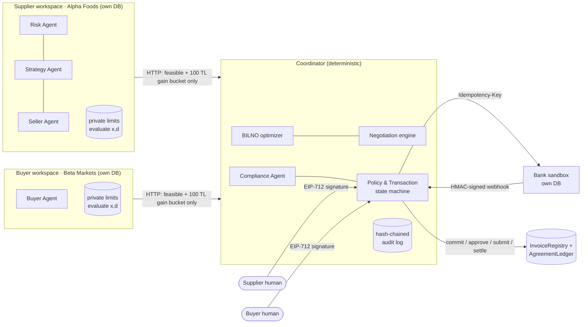

# AuditFlow AI

**Privacy-preserving multi-agent working capital optimization for SMEs.**
WeBank Fintechathon 2026, International Track, Topic E (SME Finance Copilot).

A supplier SME (Alpha Foods) will miss payroll in 10 days, although a large buyer (Beta Markets) owes it 100,000 TL
in 60 days. AuditFlow's **Risk Agent** detects the crisis with a Monte Carlo stress test. The **Strategy Agent**
compares the fixes (bank loan, payment-date shift, early payment of an invoice). A **Seller Agent** and a
**Buyer Agent** then negotiate early payment, each bound by its own company's **private limits**, which the other
side never sees. **BILNO** (Bilateral Liquidity-Neutral Optimization) computes the deal that is best for *both*
sides under their risk limits, or returns `NO_FEASIBLE_AGREEMENT`.

Both companies' authorized humans sign the exact terms (EIP-712). A **bank sandbox** executes the payment with
idempotency and HMAC-signed webhooks. Every step is committed to a shared **ledger** (Solidity contracts on an EVM
chain) and to a hash-chained audit log.

> *A good financial agent is not one that always closes a deal; it is one that refuses a bad one.*

All money math, limits and approvals are deterministic code. The LLM agents only propose, argue and explain; an
LLM output can never move money or bypass a check. The bank is simulated: this is a regulation-aware architecture
with simulated fiat execution and no production banking access.

## Architecture



The supplier and buyer code never import each other or open each other's database; this is checked by a test.
The coordinator only ever sees `feasible` and a gain rounded to 100 TL. That makes this a **confidential policy
service (trusted server-side code), not a zero-knowledge proof**.

## Quick start

```bash
make install        # Python 3.11+ venv + package (pip install -e .)
make test           # forge test (contracts) + pytest
make flow           # full flow in the terminal: detection -> negotiation -> approvals -> bank -> settlement -> ledger
make up             # terminal 1: all services (+ local anvil chain if Foundry is installed)
make ui             # terminal 2: Streamlit UI at http://localhost:8501
make demo           # end-to-end run with attacks -> docs/EXECUTION_EVIDENCE.md + evidence/
python -m experiments.run   # experiments vs baselines -> docs/EXPERIMENTS.md
```

- Foundry (`forge`, `anvil`) is needed for the contracts and for the local chain. Without it, `make flow` and
  `make up` run with the ledger disabled (`LEDGER_TARGET=none`) and say so.
- Everything runs offline (`LLM_MODE=offline`, deterministic agents) with no API key. Set `LLM_MODE=online`,
  `ANTHROPIC_API_KEY` and `LLM_MODEL` in `.env` to use Claude.
- **Base Sepolia:** copy `.env.example` to `.env` and fill in the testnet keys. Then run `make deploy`,
  `make ping`, `make up LEDGER=configured` and `make demo LEDGER=configured`.

| Make target | What it does |
|---|---|
| `make install` | venv + `pip install -e .` |
| `make build` / `make test-contracts` | `forge build` / `forge test -vv` |
| `make test-py` | `pytest` |
| `make deploy` / `make deploy-local` | deploy contracts to Base Sepolia / a running local anvil |
| `make ping` | `python -m services.ledger.client ping` |
| `make up [LEDGER=configured]` | supplier :8101, buyer :8102, coordinator :8200, bank :8300 |
| `make ui` | Streamlit, 7 screens |
| `make flow` | `python -m services.coordinator.run_flow --offline` |
| `make demo [LEDGER=configured]` | `scripts/run_demo_scenario.py` (execution evidence) |
| `make audit-verify` | verify the audit hash chain |

## Ledger

| Target | Status |
|---|---|
| **Base Sepolia** (EVM testnet, chain 84532) | Deployed by `contracts/script/Deploy.s.sol`. `InvoiceRegistry` `0xbcc371e3dfa3dc96e086bf46a673fd5abac873e4`, `AgreementLedger` `0xad29ca179ca4aef902e461d556e1872d7300546d` (`deployments/base-sepolia.json`) |
| **Local anvil** (chain 31337) | Used by the tests, `make flow` and the committed execution evidence. It is a local test chain, **not** a public testnet |
| FISCO BCOS 3.x | **Not implemented** (interface stub only). See `docs/LEDGER.md` |

## Repository

| Path | Content |
|---|---|
| `contracts/` | `InvoiceRegistry.sol`, `AgreementLedger.sol`, Foundry tests, deploy script |
| `engine/` | `stress.py` (Monte Carlo), `alternatives.py`, `bilno.py` |
| `services/supplier/`, `services/buyer/` | company workspaces: own SQLite DB, private policy, agents, FastAPI |
| `services/coordinator/` | negotiation, BILNO runner, Compliance Agent, transaction state machine, bank client, webhooks, `run_flow` |
| `services/bank_sandbox/` | simulated bank (own DB, idempotency, signed webhooks, failure injection) |
| `services/ledger/` | ledger client (EVM / disabled / FISCO stub), local anvil helper, ABIs |
| `services/common/` | config, EIP-712, LLM tool layer, negotiator, audit log, keys, rate limits |
| `ui/` | Streamlit app (7 screens) |
| `experiments/` | synthetic scenarios, baselines, evaluation |
| `scripts/` | stack launcher, end-to-end evidence run, UI screenshots |
| `evidence/` | audit + bank sandbox logs, deal records, screenshots, test output |
| `docs/` | technical documentation, security self-assessment, execution evidence, experiments |

## Documentation

- [docs/TECHNICAL_DOC.md](docs/TECHNICAL_DOC.md): problem, architecture, algorithms (stress engine, BILNO),
  negotiation, state machine, ledger design, experiments, limitations
- [docs/SECURITY_SELF_ASSESSMENT.md](docs/SECURITY_SELF_ASSESSMENT.md): threat model, permission tiers mapped to
  code and tests, S1–S10 results, known risks
- [docs/EXECUTION_EVIDENCE.md](docs/EXECUTION_EVIDENCE.md): end-to-end run with ledger tx hashes and bank payment ids
- [docs/EXPERIMENTS.md](docs/EXPERIMENTS.md): BILNO vs baselines on 200 scenarios, including where BILNO is not better
- Component notes: [LEDGER](docs/LEDGER.md), [BANK_SANDBOX](docs/BANK_SANDBOX.md),
  [COORDINATOR](docs/COORDINATOR.md), [UI](docs/UI.md)

## Team

<!-- TODO(team): add team member names and roles before submission -->
_Team member names to be added._

## License

MIT, see [LICENSE](LICENSE). All amounts and companies in this repository are fictional example data.
