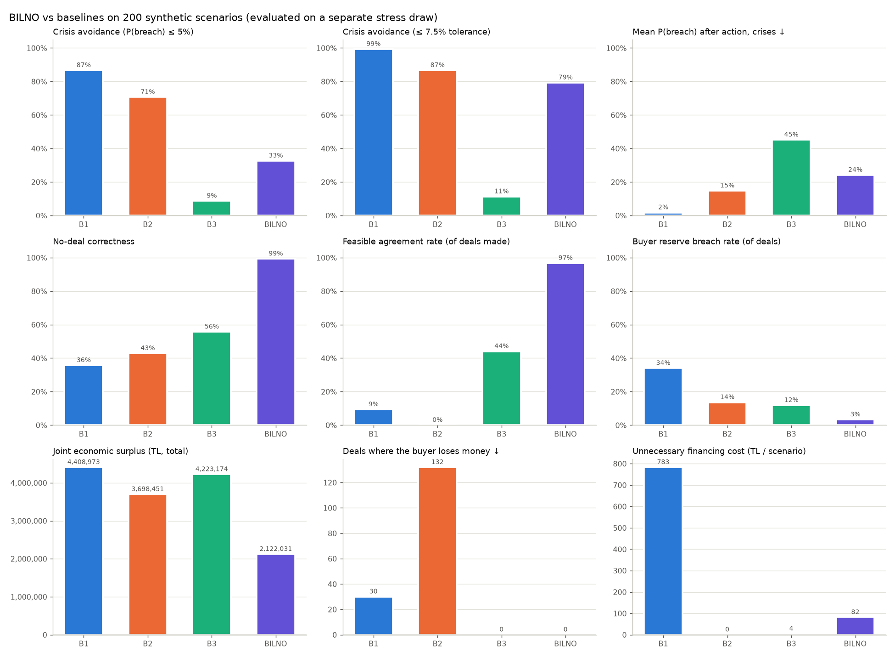

# Experiments: BILNO vs baselines

Generated by `python -m experiments.run` (scenario seed 2026, evaluation seed 777001,
200 scenarios, 1.4 min). Raw per-scenario results: `experiments/results.json`.
All numbers below come from that run. All amounts are synthetic example values.

## Setup

- **Scenarios.** 200 synthetic supplier/buyer pairs drawn from four regimes: `crisis` (50%),
  `no_need` (20%, the supplier has enough cash), `tight_buyer` (15%, the buyer's reserve is close to its cash) and
  `costly_buyer` (15%, the buyer's opportunity cost is 25–45%). Within each regime, balances, payroll, invoice size
  and due date, customer delay histories, bank terms, the supplier's max discount, and the buyer's reserve,
  opportunity cost, max early cash and other outflows are all random.
- **Production code.** Each scenario is written into in-memory SQLite databases with the real workspace schemas.
  The supplier and buyer checks are `services.supplier.policy.SupplierPolicy` and `services.buyer.policy`, and
  BILNO is `engine.bilno.decide`.
- **Models.** Each model decides with its own simulation (the engine's default seed):
  - **B1**: fixed 2% discount on the full invoice whenever the supplier's stress test says action is needed.
  - **B2**: the cheapest early payment for the supplier (smallest discount, smallest amount that passes the
    supplier's own risk test). It ignores the buyer.
  - **B3**: maximizes the Nash product of both gains under both sides' private limits (max discount, min net amount,
    max early cash), using a deterministic mean forecast. Neither side runs a stress test.
  - **BILNO**: the production decision, which includes both stress tests.

  When a model makes no deal, the supplier uses its best alternative without a deal (e.g. the bank loan) where the
  model has one.
- **Evaluation.** Every outcome is scored on a separate, freshly drawn stress set (seed 777001, 5,000
  paths), not on the model's own simulation. "Should deal" comes from an oracle: the same BILNO search, run on the
  evaluation draw.
- **Metric definitions.**
  - *Crisis*: the supplier's P(cash < reserve) before any action is > 5%. It is *avoided* if it is ≤ 5% after the
    model's action.
  - *Surplus*: the supplier's saving vs its best alternative, plus the buyer's gain `x·d − x(1−d)·r_opp·D/365`.
    Each supplier outcome costs its financing cost plus the expected shortfall left after it, with shortfall valued
    1:1 (an underestimate of what a missed payroll costs).
  - *Unnecessary financing cost*: the part of the financing cost spent on cash raised beyond what the supplier
    needed on the evaluation draw.
  - *Buyer reserve breach*: after the deal, the buyer's P(reserve breach) is above its 2% limit and higher than
    without the deal.

## Results

| Metric | B1 fixed 2% | B2 supplier-only | B3 no stress test | **BILNO** | Note |
|---|---|---|---|---|---|
| Liquidity Crisis Avoidance Rate ↑ | 86.7% | 70.7% | 8.7% | **32.7%** | of 150 crisis scenarios |
|   among avoidable crises ↑ | 87.6% | 72.7% | 7.4% | **40.5%** | of 121 crises that some action (deal or alternative) can avoid |
|   with a 7.5% tolerance ↑ | 99.3% | 86.7% | 11.3% | **79.3%** | P(breach) after ≤ 7.5%: separates near-misses at the 5% limit from unsolved crises |
| Mean P(cash < reserve) after action, crises ↓ | 1.8% | 14.8% | 45.2% | **24.2%** | evaluation draw |
| Joint Economic Surplus (total TL) ↑ | 4,408,973 | 3,698,451 | 4,223,174 | **2,122,031** | supplier + buyer gain |
|   from deals within both sides' limits (TL) | 643,630 | 0 | 2,030,578 | **2,183,169** | surplus a buyer that checks its own limits would actually agree to |
|   from deals that break a limit (TL) | 3,765,344 | 3,606,843 | 1,845,065 | **116,530** |  |
|   of which supplier gain (TL) | 4,369,170 | 3,833,938 | 4,166,192 | **2,065,539** | vs its best alternative |
|   of which buyer gain (TL) | 39,803 | -135,487 | 56,982 | **56,492** | vs paying at due date |
| Unnecessary Financing Cost (TL / scenario) ↓ | 783 | 0 | 4 | **82** | financing cost on cash raised beyond the need (evaluation draw) |
| Total financing cost (TL / scenario) | 1,969 | 200 | 1,286 | **1,335** | discount + loan + fees |
| Buyer Reserve Breach Rate ↓ | 34.0% | 13.6% | 11.9% | **3.3%** | share of deals that leave the buyer above its 2% risk limit and make it worse |
| Deals where the buyer loses money ↓ | 30 | 132 | 0 | **0** | count |
| Deals made | 150 | 132 | 118 | **61** | count |
| Feasible Agreement Rate ↑ | 9.3% | 0.0% | 44.1% | **96.7%** | share of deals within BOTH sides' limits |
| No-Deal Correctness ↑ | 35.7% | 42.9% | 55.7% | **99.3%** | of 140 scenarios where no deal should be made |
| Deal recall ↑ | 23.3% | 0.0% | 86.7% | **98.3%** | feasible deals made, of 60 scenarios where one exists |
| Execution Integrity | n/a | n/a | n/a | **13/13 security tests pass** | system property (S1–S10, unlisted tool, both approvals, audit tamper); baselines are optimizers without an execution layer |

## By regime

| Regime | Scenarios | Crisis | Should deal | BILNO deals | B1 deals | BILNO crisis avoided | B1 crisis avoided |
|---|---|---|---|---|---|---|---|
| costly_buyer | 28 | 28 | 1 | 1 | 28 | 14.3% | 85.7% |
| crisis | 100 | 99 | 59 | 60 | 99 | 40.4% | 87.9% |
| no_need | 49 | 0 | 0 | 0 | 0 | - | - |
| tight_buyer | 23 | 23 | 0 | 0 | 23 | 21.7% | 82.6% |

## Reading the results (including where BILNO is not better)

- Best per metric in this run: crisis avoidance **B1**, joint surplus
  **B1**, no-deal correctness **BILNO**, feasible agreements
  **BILNO**.
- BILNO avoided 32.7% of crises vs B1 86.7%, B2 70.7%, B3 8.7%.
  B1 avoids more crises because it always takes the full invoice at 2%. It gets there by ignoring the buyer: 30 of its 150 deals lose the buyer money and 51 push the buyer over its risk limit.
- **Edge-of-limit effect.** BILNO picks the cheapest terms that just meet the supplier's 5% risk limit on its own simulation. On the fresh draw, 24 of its 61 crisis deals land between 5% and 7.5% and 0 land above 7.5%. Its bank-loan fallback is sized the same way. The strict 5% rate therefore understates it: with a 7.5% tolerance BILNO reaches 79.3%. A production version should target a safety margin below the limit (not implemented).
- **Partial relief is refused.** BILNO only accepts terms that bring the supplier within its risk limit. When no single invoice can do that, it makes no deal, even if a deal would cut the expected shortfall a lot. B3 makes such deals, and because its deterministic forecast underestimates the need, it also sizes them too small (105 of 118 of its crisis deals raise less cash than the stress-tested need). Its mean P(breach) after action is 45.2% vs BILNO 24.2%. Its surplus still counts the partial shortfall reduction, valued 1:1. Without a buyer stress test, 14 of its 118 deals leave the buyer above its risk limit.
- Deals that lose the buyer money: B1 30, B2 132, B3 0, BILNO 0. Buyer reserve breaches: B1 51, B2 18, B3 14, BILNO 2.
- **BILNO is not the surplus maximum here.** B1, B2 and B3 all show a higher total joint surplus. The share of each total that comes from deals breaking a side's limits is B1 85%, B2 98%, B3 44%. A buyer that checks its own limits would not agree to those deals. Counting only deals within both sides' limits, the order is BILNO 2,183,169 TL, B3 2,030,578 TL, B1 643,630 TL, B2 0 TL.
- BILNO's no-deal correctness is 99.3%, not 100%: in some scenarios it made a deal on its own simulation where the oracle, on the fresh draw, found none.
- B1: limits its deals fail on the evaluation draw: `buyer:max_early_cash` ×106, `supplier:gain_vs_best_alternative` ×51, `buyer:gain_vs_paying_at_due_date` ×30, `buyer:reserve_risk_limit` ×19, `supplier:liquidity_risk_limit` ×7.
- B2: limits its deals fail on the evaluation draw: `buyer:gain_vs_paying_at_due_date` ×132, `buyer:max_early_cash` ×37, `supplier:liquidity_risk_limit` ×3.
- B3: limits its deals fail on the evaluation draw: `buyer:reserve_risk_limit` ×60, `supplier:gain_vs_best_alternative` ×9, `supplier:liquidity_risk_limit` ×6.
- BILNO: limits its deals fail on the evaluation draw: `buyer:reserve_risk_limit` ×2.

## Limitations

- The scenarios are synthetic, and the regimes were chosen by us. The real-world mix of cases is unknown.
- B3's "no stress test" uses a deterministic mean forecast. Other ways to drop the stress test would give other
  numbers.
- The oracle uses the same grid search as BILNO, on the evaluation draw. A feasible point between grid steps could
  be missed.
- BILNO's evaluation draw differs from its own simulation only in the random seed, not in the model. A wrong delay
  model would hurt BILNO and the oracle alike.
- Execution integrity is measured by our own security tests, not by an external audit.
