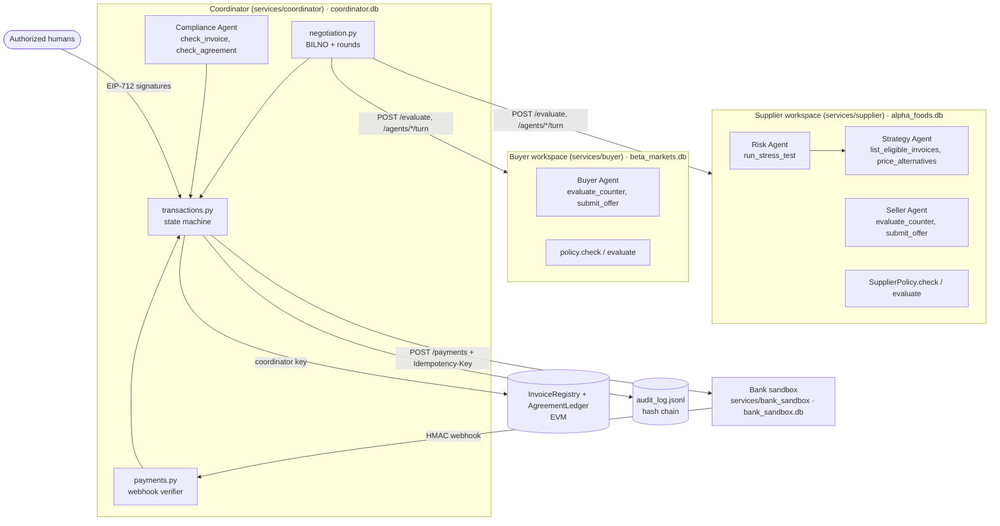
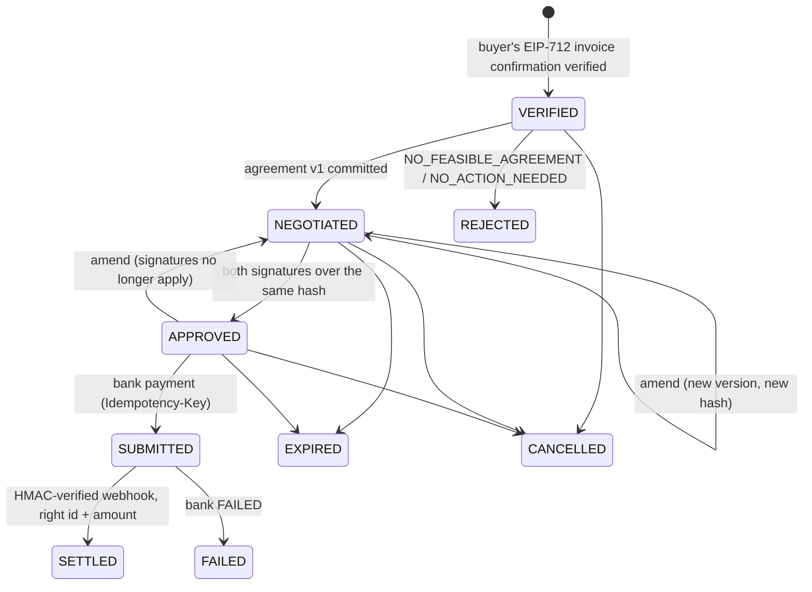

# AuditFlow AI: technical documentation

Every claim in this document points to the code or test that implements or proves it. Gaps are listed at the
end. All amounts are example values.

## 1. Problem

Small suppliers often hit a cash crisis while large buyers owe them money that is due later. Early payment at a
discount (dynamic discounting) can fix this more cheaply than a bank loan, but in practice:

- the supplier does not know whether a discount is good value compared with its other options;
- the buyer will only pay early if it earns more than it loses on its cash, and without hurting its own liquidity;
- neither side wants to reveal its cash position or limits to the other;
- an AI agent that negotiates must not be able to agree to bad terms, be talked into them (prompt injection), or
  move money on its own.

AuditFlow detects the crisis, prices every alternative, and lets two agents negotiate inside private, code-enforced
limits. A deterministic optimizer (BILNO) checks that a deal is good for both sides and safe for both sides'
liquidity, or refuses it. The deal is then executed only after both companies' humans sign the exact terms.

## 2. Architecture

- **Four services, four databases.** Supplier, buyer, coordinator and bank are separate FastAPI processes
  (`scripts/stack.py`, `services/coordinator/run_flow.py`).
- **Data isolation.** Supplier code never imports buyer modules or opens the buyer's DB, and vice versa
  (`test_isolation_supplier_never_imports_buyer_and_vice_versa`). The bank and coordinator import neither
  workspace (`test_isolation_bank_and_coordinator_never_import_company_workspaces`).
- **UI.** The Streamlit UI (`ui/`, 7 screens) is a thin HTTP client with no business logic (`docs/UI.md`).

## 3. Agents and tool permissions

| Agent | Runs in | Tools | Can never | Code |
|---|---|---|---|---|
| Risk Agent | supplier | `run_stress_test` | pay, negotiate | `services/supplier/agents.py` |
| Strategy Agent | supplier | `list_eligible_invoices`, `price_alternatives` | sign, approve | same |
| Seller Agent | supplier | `evaluate_counter`, `submit_offer` | offer above the supplier's max discount or below its min net amount, or fail its risk limit | `services/common/negotiator.py` |
| Buyer Agent | buyer | `evaluate_counter`, `submit_offer` | exceed max early cash, fail the reserve risk limit, take a loss | same |
| Compliance Agent | coordinator | `check_invoice`, `check_agreement` | change policies or limits | `services/coordinator/compliance.py` |

Each agent gets its own `ToolRegistry` (`services/common/llm.py`). Calling any tool it does not own raises
`UnlistedToolError` and is audit-logged as tier T5 (`test_agent_cannot_call_unlisted_tool`).

`submit_offer` runs `Negotiator.validate_offer()`. This checks the amount and discount grid, the public 5% cap,
and the company's own private `check()`. It rejects violations in code, whatever a model proposed (`test_S3_*`,
`test_S4_*`, `test_S5_*`).

Untrusted text (invoice memos, the other side's messages) reaches a model only inside `<untrusted>` tags. The system
prompt says limits are enforced by code and private numbers must not be revealed.

Online mode uses the Anthropic Messages API with a manual tool loop, `tool_choice: auto`, `strict` schemas and the
server-side refusal fallback. Offline mode (`LLM_MODE=offline`, the default) uses deterministic strategies through the
same registries and validation.

## 4. Stochastic Liquidity Stress Engine (`engine/stress.py`)

- **Simulation.** Daily simulation over `H = 60` days and `N = 5,000` paths, with a fixed seed (42) for
  reproducibility (`test_reproducible_with_fixed_seed`). `Cash_t = Cash_0 + Σ inflows − Σ outflows` per path.
- **Inflows.** Each open, confirmed, undisputed receivable arrives at `due_day + delay`, where `delay` is
  **bootstrapped** from that customer's own historical delays. Daily sales are `Normal(mean, sd)`, floored at 0.
- **Outflows.** Scheduled payments (payroll, rent) are fixed. Variable expenses are `Normal(mean, sd)`, floored at 0.
- **Scenarios.** `normal`; `late_payments` (delays × 1.5); `stress` (delays × 2, expenses +20%)
  (`test_stress_scenarios_are_ordered`).
- **Outputs.**
  - `p_breach = P(min_t Cash_t < reserve)`;
  - `expected_max_shortfall = E[max(0, reserve − min_t Cash_t)]`;
  - `first_critical_date` (first day the median path is below the reserve);
  - p5/p50/p95 bands;
  - `compare()` for the Before/After view.
- **Seed scenario.** Crisis on payroll day, with `p_breach` > 50% (`test_seed_crisis_on_payroll_day`). A 58,800 TL
  inflow today brings it to ≤ 5% (`test_early_payment_inflow_fixes_crisis`).
- **Required injection.** `required_injection(profile, α)` is the smallest cash injection today that brings
  `p_breach` to α. That is the supplier's need `N`.

## 5. Alternatives (`engine/alternatives.py`)

For the need `N` over the invoice horizon `D` days:

- **Bank loan:** `cost = N · r_bank · D/365 + fee`. It is infeasible if the money arrives on or after the first
  critical day, or if the stress test with the loan still exceeds α.
- **Early payment** at discount `d`: `APR ≈ d/(1−d) · 365/D` (`test_sanity_example_numbers`: 12.41%).
- **Payment-date shift:** costs the configured fee, and only applies to outflows the counterparty allows to move.
- **Do nothing:** feasible only if `p_breach ≤ α_S` (`test_no_action_needed_when_cash_is_high`).

The supplier's best alternative without a deal (its BATNA) is the cheapest feasible one. If none is feasible,
its cost is the expected shortfall.

## 6. BILNO: Bilateral Liquidity-Neutral Optimization (`engine/bilno.py`)

**Variables.**
- `x` = face amount settled early, in 1,000 TL steps with `x ≤ F`. If `ALLOW_PARTIAL=false`, then `x = F` only
  (`test_full_amount_only_when_partial_not_allowed`).
- `d` = discount, in 0.1% steps with `0 < d ≤ 5%` (the public bound). Each side's private `d` limit is enforced
  inside its own `evaluate`.

**Utilities** (`services/supplier/policy.py`, `services/buyer/policy.py`):

- Supplier: receives `x(1−d)` now. The remaining need `N' = max(0, N − x(1−d))` is covered by the bank loan.
  `U_S − U_S0 = C_alt_S − (x·d + N'·r_bank·D/365 [+ fee])`.
- Buyer: `U_B − U_B0 = x·d − x(1−d)·r_opp_B·D/365`. Sanity check: `F = 100,000`, `x = 60,000`, `d = 2%`,
  `D = 60`, `r_opp = 9%` gives a cash cost of ≈ 870 and a gain of ≈ 330 (`test_sanity_example_numbers`).

**Objective.** Maximize the Nash product `(U_S − U_S0)(U_B − U_B0)` subject to:
- both gains > 0;
- `P(supplier shortfall after the deal, with the residual loan) ≤ α_S` (supplier stress test);
- `P(buyer reserve breach after paying early) ≤ α_B`, using the buyer's own stress test run **inside the buyer
  workspace**;
- `d ≤ d_max_S`, `x(1−d) ≥ min_net_S` and `x(1−d) ≤ max_early_cash_B`.

**No-deal rule.** If no `(x, d)` meets every constraint, the result is `NO_FEASIBLE_AGREEMENT` plus the best
alternative (`test_no_deal_when_buyer_reserve_too_high`: buyer reserve 440,000 → bank loan). If the supplier needs
no action, the result is `NO_ACTION_NEEDED`.

**Privacy interface.**
- Each workspace exposes only `evaluate(x, d) → {feasible, gain_bucket}`, with the gain rounded to 100 TL
  (`test_evaluate_reveals_no_private_numbers`, `test_buyer_evaluate_reveals_only_feasibility_and_bucket`).
- The search is a coarse grid (10% of F × 0.5%) followed by two one-variable refinement rounds. It stays well under
  the **200 evaluations per negotiation** limit (`test_optimizer_stays_within_evaluation_budget`).
- Each workspace also enforces at most 3 negotiations per invoice (`test_S10_limit_probing_rate_limited`).

This is a confidential policy service, **not a zero-knowledge proof**: the coordinator trusts each workspace's
answer, and the bucket leaks coarse information.

## 7. Negotiation protocol (`services/coordinator/negotiation.py`)

1. BILNO computes the reference `(x*, d*)` (or no-deal).
2. The Seller Agent opens. The Buyer Agent checks the offer privately and counters. Each side has at most 3 turns.
   Offline strategy: the seller (who wants a low `d`) concedes `d*−0.4% → d*−0.2% → d*`, and the buyer (who wants a
   high `d`) concedes `d*+0.4% → d*+0.2% → d*`. Each side accepts the other's offer once it is at least as good as
   its own plan for that round.
3. Every offer passes `validate_offer()` in its own workspace.
4. The deal closes only if one side accepts the other's exact offer, **and** both workspaces still call it
   feasible, **and** its Nash product is within 10% of the optimum. Otherwise the result is
   `NO_FEASIBLE_AGREEMENT`.
5. The full transcript (offers, tool calls, blocked attempts, checks) is stored and shown in the Negotiation Room.

## 8. Agreement, approvals and state machine (`services/coordinator/transactions.py`)

- **Canonical agreement:** `agreement_id, version, invoice_id, invoice_hash, seller, buyer, face_amount_x,
  discount_bps, pay_amount, currency, payee_account, expires_at, idempotency_key`. Amounts are integer kuruş, and
  `pay_amount = face·(10,000 − bps) // 10,000`, the same formula the contract checks.
- **`agreement_hash`** is the EIP-712 digest under the `AuditFlow AgreementLedger` domain
  (`services/common/eip712.py`). It equals the on-chain `hashAgreement` (`test_onchain_flow_and_approval_checks`,
  `test_AgreementHashMatchesOffChainEIP712`).
- **Illegal transitions** raise HTTP 409 (`test_illegal_transitions_raise`).
- **APPROVED** requires both human signatures to recover to the seller's and buyer's approver addresses over the
  current version (`test_settlement_requires_both_approvals`). Any change creates a new version with a new hash
  and a new idempotency key, and the old signatures stop applying (`test_S6_changed_amount_invalidates_approval`,
  `test_onchain_superseded_version_cannot_be_approved`). Expiry is enforced
  (`test_expired_agreement_cannot_be_approved`).
- **VERIFIED** requires the buyer's own EIP-712 invoice confirmation; the supplier's flag is not trusted
  (`test_S1_forged_invoice_not_verified`). A duplicate invoice hash is refused off-chain and on-chain
  (`test_S2_duplicate_invoice_rejected`).
- **SUBMITTED** uses the bank client, which retries with the **same** idempotency key (`test_S9_bank_outage_safe_retry`).
- **SETTLED** happens only on an HMAC-verified webhook (`test_S8_forged_webhook_rejected`). A poll alone never
  settles (`test_polling_alone_never_settles`).
- **Audit log** (`services/common/audit.py`): append-only, hash-chained JSONL (`seq, ts, actor, action, tier,
  inputs_hash, result, prev_hash, entry_hash`), with a `verify` CLI and endpoint
  (`test_audit_chain_tamper_detected`).

## 9. Ledger design (`contracts/`, `services/ledger/`)

- **`InvoiceRegistry`** registers invoices by hash (each hash can be used once). It records the buyer's
  confirmation, by a direct call or by an EIP-712 signature relayed by the coordinator. Status:
  `Registered → Confirmed → Settled | Cancelled`.
- **`AgreementLedger`:**
  - `commitAgreement` (COORDINATOR_ROLE only): the invoice must be confirmed, the terms must match the registry,
    `payAmount` is re-checked on-chain, and only one agreement per invoice can be active.
  - `approve`: verifies an EIP-712 signature from the invoice's seller or buyer.
  - `recordSubmission`: reverts unless **both** approvals exist and the agreement has not expired.
  - `recordSettlement`: only after submission; marks the invoice Settled.
  - Also `recordFailure`, `supersede`, `pause` and events.
  - **AI agents hold no key.**
  - 38 Foundry tests cover the happy path and every revert listed in the plan (`contracts/test/`).
- **Why a shared ledger instead of only the hash-chained log?** The audit log proves integrity only to whoever
  trusts the operator: the coordinator could rewrite the whole chain. Supplier, buyer (and later bank or
  auditor) are separate organizations that need to verify **the same** facts independently. That means which
  exact terms were committed, who approved which hash, and that settlement happened once. On the ledger these facts
  are checked by contract rules that the coordinator cannot bypass (e.g. no submission without both approvals,
  enforced on-chain). Each party can verify them without trusting the coordinator's database.
- **Targets.** Base Sepolia (deployed: `deployments/base-sepolia.json`; execution evidence), **FISCO BCOS 3.17.1**
  (local 4-node PBFT chain through its Web3-compatible RPC; `deployments/fisco-local.json`; execution evidence in
  `docs/EXECUTION_EVIDENCE_FISCO.md`) and local anvil (tests, `make flow`). See `docs/LEDGER.md`.

## 10. Experiments (summary of `docs/EXPERIMENTS.md`)

The setup:
- 200 seeded synthetic scenarios across four regimes;
- B1 (fixed 2% on the full invoice), B2 (supplier-only optimizer), B3 (both gains, no stress tests) and BILNO;
- outcomes evaluated on a **separate stress draw** using the production policy code.

| | B1 | B2 | B3 | BILNO |
|---|---|---|---|---|
| Feasible agreement rate (deals within both sides' limits) | 9.3% | 0.0% | 44.1% | **96.7%** |
| No-deal correctness | 35.7% | 42.9% | 55.7% | **99.3%** |
| Deals where the buyer loses money | 30 | 132 | 0 | **0** |
| Joint surplus from deals within both sides' limits (TL) | 643,630 | 0 | 2,030,578 | **2,183,169** |
| Crisis avoidance (P(breach) ≤ 5% on the fresh draw) | **86.7%** | 70.7% | 8.7% | 32.7% |
| Crisis avoidance with 7.5% tolerance | **99.3%** | 86.7% | 11.3% | 79.3% |
| Total joint surplus (TL) | **4,408,973** | 3,698,451 | 4,223,174 | 2,122,031 |

**Where BILNO is weaker:**
- **Crisis avoidance.** B1 avoids more crises by taking the full invoice whatever the buyer's limits; 85% of its
  surplus comes from deals that break a limit.
- **Edge of the limit.** BILNO's terms sit right at the 5% risk limit, so many land at 5–7.5% on a fresh draw. A
  safety margin is not implemented.
- **Partial relief.** BILNO refuses deals that only partly relieve a crisis.

## 11. Limitations and gaps

| Gap | Status |
|---|---|
| Online LLM mode | Implemented; the SDK request/response path is tested with a mocked transport (`test_online_backend_request_shape_and_turn`). It was not run against the live API in this repository |
| FISCO BCOS | Runs on a **local** 4-node chain on one machine (all nodes run by us), via the Web3 RPC, not FISCO's native SDK. Not a multi-organization deployment |
| Zero-knowledge proofs | None. Privacy is a trusted server-side policy service |
| BILNO safety margin and partial relief | Not implemented (see §10) |
| Partial early payment accounting (ERP, credit notes, tax) | Not built; the supplier's receivable status is not updated after settlement |
| Approver keys | Demo keys held server-side. If unset, they are public anvil test keys |
| Balances | Self-reported by each workspace; no bank attestation |
| Rationale leakage in online mode | Prompt-level only, no code filter (`docs/COORDINATOR.md`) |
| Gain-bucket visibility | The deal record (BILNO result incl. both gain buckets) is shown to every role in the demo UI; it should be coordinator/auditor-only |
| Service authentication | The services have no authentication between them, and the role switcher in the UI is not authentication |

See `docs/SECURITY_SELF_ASSESSMENT.md` for the threat model and the risk register.
